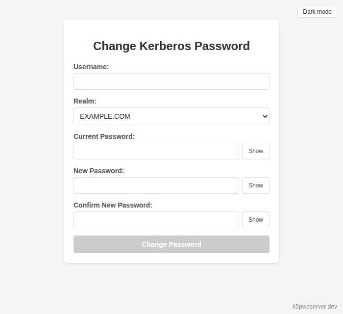
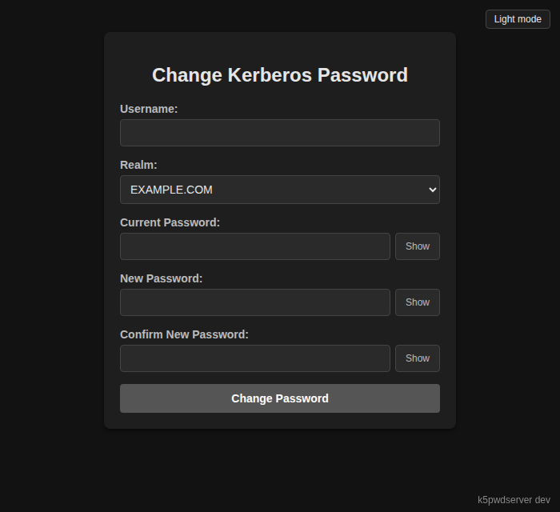

# k5pwdserver

[](https://github.com/edward-murrell/k5pwdserver/actions/workflows/ci.yml)

A small web service that lets users change their own Kerberos password.

It works with MIT krb5, Heimdal and Active Directory/Samba KDCs. Password
changes use the kpasswd change-password protocol (RFC 3244, version 1), because
gokrb5's built-in set-password request is rejected by AD/Samba.

<p>
  
  
</p>

The page follows the browser's light or dark setting. The button at the top
right overrides it.

## Running

```sh
go run ./cmd/pwdserver
```

The server reads realms and KDCs from `/etc/krb5.conf` and listens on `:8080`.
Open `http://<host>:8080/` in a browser.

## Options

| Flag        | Default                    | Description                                        |
|-------------|----------------------------|----------------------------------------------------|
| `-listen`   | `:8080`                    | Address to listen on, as `host:port`.              |
| `-tls-cert` |                            | PEM certificate file. Set with `-tls-key` for HTTPS. |
| `-tls-key`  |                            | PEM private key file.                              |
| `-realms`   | every realm in `krb5.conf` | Comma-separated realms users may pick.             |
| `-title`    | `Change Kerberos Password` | Page title and heading.                            |

Realm names are case-sensitive. If `krb5.conf`'s default realm isn't in
`-realms`, the first listed realm becomes the default.

```sh
go run ./cmd/pwdserver -realms EXAMPLE.COM,OTHER.ORG -title "Example Corp passwords"
```

## TLS

The server speaks plain HTTP by default. Don't expose plain HTTP beyond
localhost, because passwords cross the network. To serve HTTPS directly, pass
a PEM certificate and key:

```sh
go run ./cmd/pwdserver -listen :8443 -tls-cert cert.pem -tls-key key.pem
```

The server reloads the certificate when either file changes, so renewals need
no restart. You can also run it on localhost behind a TLS proxy.

## Debian package

The package installs `/usr/sbin/k5pwdserver` and a `k5pwdserver` systemd
service. Set options in `/etc/default/k5pwdserver`, then restart the service.
By default it listens on `127.0.0.1:8080`.

```sh
LISTEN=:443
TLS_CERT=/etc/letsencrypt/live/example.com/fullchain.pem
TLS_KEY=/etc/letsencrypt/live/example.com/privkey.pem
REALMS=EXAMPLE.COM
TITLE=Example Corp passwords
```

The service runs as a dynamic user, so it must be able to read the TLS key.
The comments in `/etc/default/k5pwdserver` show how to grant access.

To build a package for the release you're running, as root from the repo root:

```sh
packaging/build-deb.sh 0.1.0
```

## Docker

Release tags publish an image to `ghcr.io/edward-murrell/k5pwdserver`. Mount
the host's `krb5.conf`, and pass flags after the image name:

```sh
docker run -d -p 8443:8443 \
  -v /etc/krb5.conf:/etc/krb5.conf:ro \
  -v /etc/k5pwdserver/tls:/tls:ro \
  ghcr.io/edward-murrell/k5pwdserver \
  -listen :8443 -tls-cert /tls/cert.pem -tls-key /tls/key.pem
```

The container runs as a non-root user, so the key must be readable by UID
65532. Without flags it serves plain HTTP on port 8080.

To build the image locally:

```sh
docker build --build-arg VERSION=0.1.0 -t k5pwdserver .
```

## API

- `GET /api/realms` – allowed realms and the default realm.
- `POST /api/change-password` – JSON body:
  `{"username", "realm", "oldPassword", "newPassword"}`.
  `realm` is optional and defaults to the default realm.
  Returns 200 on success, 401 for wrong current credentials, 400 if the new
  password fails the KDC's password policy or the realm isn't allowed, 415 if
  the request isn't `application/json`, and 500 for other errors.

## Development

```sh
go vet ./...
go test ./...
```

GitHub Actions runs these on every push and pull request.

The page footer shows the package name and version. Builds without a version
show `dev`. To set one:

```sh
go build -ldflags "-X github.com/edward-murrell/k5pwdserver/internal/version.Version=1.2.3" ./cmd/pwdserver
```

## Upgrading Vue

The page uses a bundled copy of Vue, embedded from
`internal/server/web/vue-<version>.global.prod.js`. To upgrade it:

1. Pick a release that has been out for at least two weeks:

   ```sh
   curl -s https://registry.npmjs.org/vue | jq -r '.time | to_entries[]
     | select(.key | test("^3\\.[0-9]+\\.[0-9]+$")) | "\(.value) \(.key)"' | sort | tail
   ```

2. Download the package and check it matches the registry's hash:

   ```sh
   V=3.5.44
   curl -s https://registry.npmjs.org/vue/$V | jq -r .dist.integrity
   curl -sO https://registry.npmjs.org/vue/-/vue-$V.tgz
   echo "sha512-$(openssl dgst -sha512 -binary vue-$V.tgz | base64 -w0)"
   ```

   The two hashes must be the same.

3. Replace the bundled file and licence:

   ```sh
   tar -xzf vue-$V.tgz package/dist/vue.global.prod.js package/LICENSE
   git rm internal/server/web/vue-*.global.prod.js
   cp package/dist/vue.global.prod.js internal/server/web/vue-$V.global.prod.js
   cp package/LICENSE internal/server/web/vue-LICENSE
   ```

4. Update the version in `internal/server/setup.go`, in both the `//go:embed`
   line and `vuePath`. Also update it in `TestVueAsset` in
   `internal/server/setup_test.go`.

5. Run `go test ./...` and load the page in a browser.

Use the `global.prod` build. It includes the template compiler the page needs.

## Releasing

1. Add an entry to the top of `debian/changelog` with the new version.
2. Commit, then push a matching tag, such as `v0.1.0`.

The release workflow then:

- builds and install-tests `.deb` packages for jammy, noble, bookworm and
  trixie, on amd64 and arm64
- attaches them to the GitHub release
- pushes the image to GHCR
- asks the packages repo to republish

The tag must match the `debian/changelog` version, or the workflow stops.
